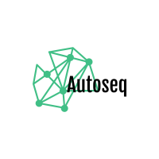
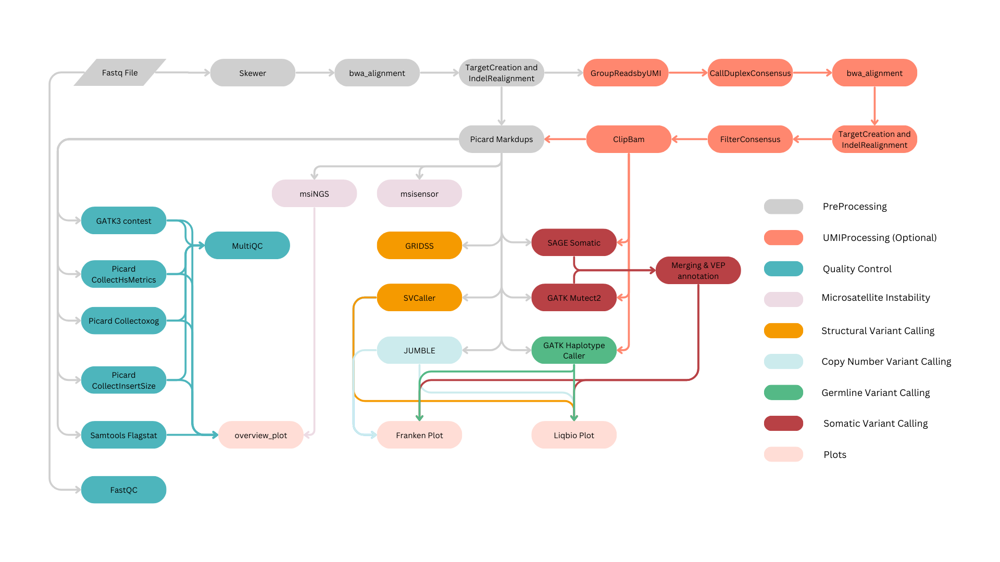

# Autoseq framework

    

> **Note:** The documentation for this repository is not currently up to date. We are actively working on updating it and will provide more information soon.

Autoseq consists of a custom-pipeline with additional support modules aimed primarily for the analysis of data from high-throughput sequencing of liquid biopsies. However the pipeline performs equally well with data from tissues with slight change in recommended settings. The pipeline is continuously developed and supported at Johan Lindberg's Cancer Genomics lab at Karolinska Institutet, Stockholm, Sweden. 

This is the latest port of the pipeline to snakemake framework with improvements in containerization, workflow management and upgrades in individual steps like variant calling, alignment and downstream processing of variants. Previous versions of autoseq pipeline have now been discontinued and can be found here (https://github.com/ClinSeq/autoseq). 

In this new version, the focus has been on the forward compatibility of the tools, deployability to cloud environments and improvements in parallelization of compute-intensive and memory-heavy steps.

## Structure
The repo is organized into four essential compartments -

- rules - all snakemake rule files for various steps and processes in the pipeline
- config and settings - configuration (*.yaml) files for the pipeline and workflow settings
- env - all necessary conda and linux environments
- scripts - supporting scripts and utilities for additional functionalities for the pipeline

## Authors

- [Sarath Kumar Murugan](https://github.com/imsarath) ([ORCID](https://orcid.org/0000-0001-7378-7869))
- [Venkatesh Chellappa](https://github.com/drvenki) ([ORCID](https://orcid.org/0000-0003-1431-6949))
- [Rebecka Bergström](https://github.com/rebber) ([ORCID](https://orcid.org/0000-0001-7609-0733))
- Markus Mayrhofer ([ORCID](https://orcid.org/0000-0003-3403-0083))
- Johan Lindberg ([ORCID](https://orcid.org/0000-0003-3610-6774))

All authors are affiliated with Karolinska Institutet, Stockholm, Sweden.

## Citation

If you use Autoseq, please cite it using the metadata in [`CITATION.cff`](CITATION.cff) (GitHub's "Cite this repository" button generates APA and BibTeX from it).

## License

Autoseq is licensed under the [GNU General Public License v3.0 or later](LICENSE).

# Pipeline 
NGS-data analysis pipeline written in python for very deep targeted resequencing data from custom panels and works well with targeted or whole-exome data as well. Contains the essential steps (QC, trimming, alignment, realignment, variant calling, prioritization, reporting). Variants from raw VCF file are annotated using VeP! and run through a set of semantic filters to eliminate irrelevant, invalid and non-significant calls. These filters (frequency, functional significance, relevance to type of disease, etc.) have been implemented after elaborate testing with different settings for both data and the callers. 
The data points in results files are suitable for manual curation in IGV after which they could be exported as a text file or HTML report or a PDF report.

